<h2 data-importer="text" align="left">Hello There, I'm Jared 👋</h2>

###

  

###

  
  

###

<h2 data-importer="text" align="left">Tech Stack</h2>

###

  
  
  
  
  
  
  
  
  
  
  
  
  
  
  
  
  

###

<picture data-importer="pacman">
  <source media="(prefers-color-scheme: dark)" srcset="https://raw.githubusercontent.com/xorznbleahc/xorznbleahc/pacman-output/pacman-contribution-graph-dark.svg?game=pacman">
  <source media="(prefers-color-scheme: light)" srcset="https://raw.githubusercontent.com/xorznbleahc/xorznbleahc/pacman-output/pacman-contribution-graph.svg?game=pacman">
  
</picture>

###

  

###
